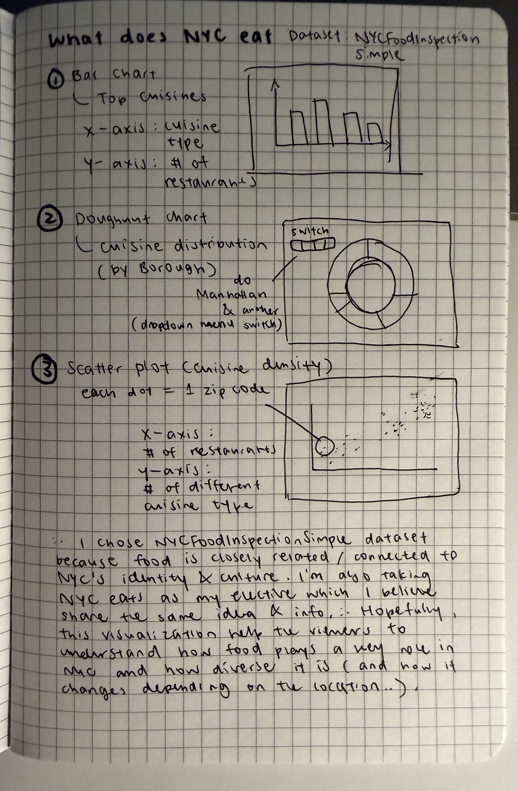

# What Does NYC Eat? — Exploring Cuisine Diversity Across New York City

**Live site:** https://lululamuz.github.io/nyc-food-viz/

An interactive Chart.js project looking at some of the most common restaurant cuisines across NYC. Users can choose a borough from the dropdown, switch between a doughnut chart and a bar chart, and hover over the chart to see the number of restaurants and percentage for each cuisine.

## Project structure

| File | Purpose |
|---|---|
| `index.html` | Main page structure, including the title, controls, chart, insight text, and data source. |
| `style.css` | Styling for the page, including the dark background, typography, spacing, and responsive layout. |
| `script.js` | Loads the data, updates the borough dropdown, and redraws the Chart.js visualization when the user changes the view. |
| `data.json` | Processed data for All NYC and each borough, including the top cuisines and an “other” category. |
| `prepare_data.py` | Python/pandas script used to clean and organize the original CSV into the final JSON data. |
| `images/` | Food images used in the doughnut chart. |
| `sketches/sketches.jpg` | My three Phase 1 visualization sketches. |

## Features

- Chart.js visualization
- Borough dropdown for All NYC, Manhattan, Brooklyn, Queens, Bronx, and Staten Island
- Toggle between doughnut and bar chart views
- Hover tooltips showing restaurant count and percentage
- Custom food-image slices in the doughnut chart
- Short insight text for each borough
- Consistent cuisine colors across boroughs for easier comparison

## Dataset

I used the [NYCFoodInspectionSimple](https://data.cityofnewyork.us/Health/NYCFoodInspectionSimple/sfd3-axrg) dataset from NYC Open Data.

The original dataset contains a very large number of rows because one restaurant can appear multiple times for different inspections or violations. I cleaned the data by removing duplicate restaurant entries using restaurant name, street, and ZIP code, and also removed entries that were missing cuisine or borough information.

The final visualization uses the most common cuisines for NYC overall and for each borough.

## Phase 1: Design

### Why this dataset

I chose the NYC restaurant inspection dataset because food is one of the things that makes New York feel really different from place to place. I wanted to look at which cuisines appear the most across the city and whether the mix changes depending on the borough. I also thought it would be interesting to compare the boroughs visually instead of only looking at the raw data.

### Sketches

All three sketches are shown here:

**Sketch 1: Bar chart — Top 10 cuisines in NYC**  
X-axis: cuisine type  
Y-axis: number of restaurants  

Possible Chart.js features: bar chart, axis labels, title, and hover tooltips.

**Sketch 2: Doughnut chart — Cuisine distribution by borough**  
This became the main direction I developed for the final project. A dropdown allows the user to switch between boroughs.

Possible Chart.js features: doughnut chart, legend, dropdown interaction, and custom tooltips.

**Sketch 3: Scatter plot — Restaurant count vs. cuisine diversity by ZIP code**  
Each point represents one ZIP code.  
X-axis: number of restaurants  
Y-axis: number of different cuisine types  

Possible Chart.js features: scatter chart, linear axes, and hover tooltips.

## External resources & AI use

- **Chart.js documentation**: used to check chart options, tooltips, legends, and chart updates.
- **NYC Open Data**: used for the original restaurant dataset and column information.
- **Food images**: used for the custom doughnut chart visuals.
- **AI tools**: I used AI mainly when I got stuck on specific parts of the project, especially while debugging some of the JavaScript and figuring out why the chart was not running correctly. I also used it near the end to help troubleshoot a few final issues with the page and Chart.js behavior. The main design decisions, dataset choice, layout, and overall direction were developed by me.

Example prompts included:
- “Why is my Chart.js chart not updating when I change the borough?”
- “Can you help me figure out why this part of my JavaScript is not running?”
- “My chart works in one view but breaks when I switch chart types. What could be causing this?”
- “Can you help me debug the final layout and chart loading issues?”
